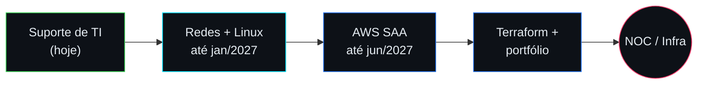

<p align="center">
  
</p>

<p align="center">
  
</p>

<p align="center">
  <a href="https://www.linkedin.com/in/nathan-emanuel-macedo/"></a>
  <a href="mailto:nathancybersec@gmail.com"></a>
  <a href="https://github.com/NathanCyber-Sec/Home-Lab"></a>
</p>

---

### `> show running-config | section nathan`

```cisco
hostname nathan-macedo
!
interface Carreira0/0
 description Suporte de TI (field + helpdesk) -> NOC / Infraestrutura de Redes
 ip address 10.0.0.1 255.255.255.0
 no shutdown
!
interface Formacao0/1
 description Redes de Computadores - Estacio (conclusao 07/2027)
 no shutdown
!
router foco
 network routing-switching
 network vlan-nat-dhcp
 network firewall-virtualizacao-linux
 passive-interface security   ! IDS/SIEM como diferencial, nao como destino
!
banner motd ^ Aprendo quebrando o proprio lab e documentando o conserto ^
!
end
```

### `> show ip interface brief`

```text
Interface                  Status        Protocol   Nota
Redes (VLAN/NAT/DHCP)      up            up         MikroTik + OPNsense no lab
Linux (Debian/Ubuntu)      up            up         daily driver
Virtualizacao (Proxmox)    up            up         homelab dedicado
Active Directory           up            up         no trabalho + lab
Seguranca (Suricata/Wazuh) up            up         mini-SOC v1 do lab
Routing (OSPF)             up            down       estudando agora
AWS                        admin down    down       proxima fase
Terraform                  admin down    down       depois da AWS
```

### `> show inventory`

<p>
  
  
  
  
  
  
  
  
  
  
  
  
  
</p>

### `> show license`

<p>
  
  
  
  
</p>

### `> show ip route projetos`

| Code | Projeto | O que é |
|---|---|---|
| `L` lab | **[Home-Lab](https://github.com/NathanCyber-Sec/Home-Lab)** | Homelab de infra: Proxmox, OPNsense, MikroTik com VLANs e AD, com os erros e consertos documentados |
| `C` produção | **[MeuTecnico](https://github.com/NathanCyber-Sec/MeuTecnico)** | Site em produção de uma assistência técnica: [omeutecnico.com.br](https://omeutecnico.com.br/) |

### `> traceroute carreira`



---

<p align="center">
  <code>! "Se não está documentado, não aconteceu." 🐧</code>
</p>
